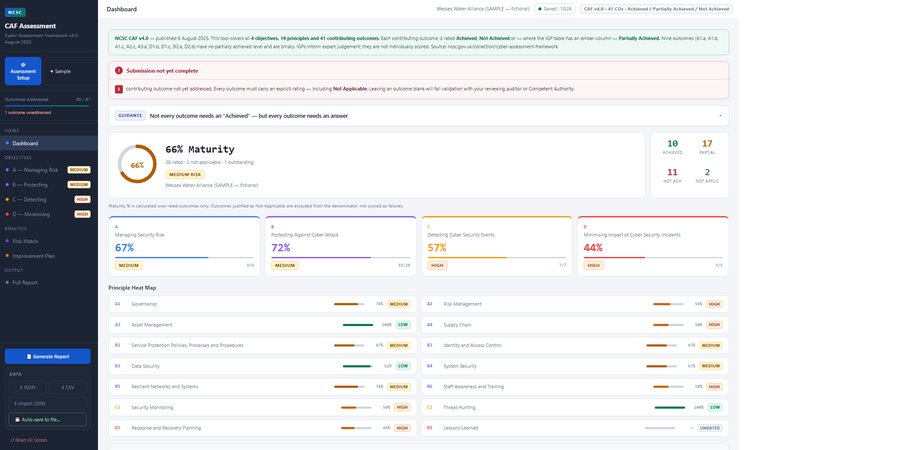
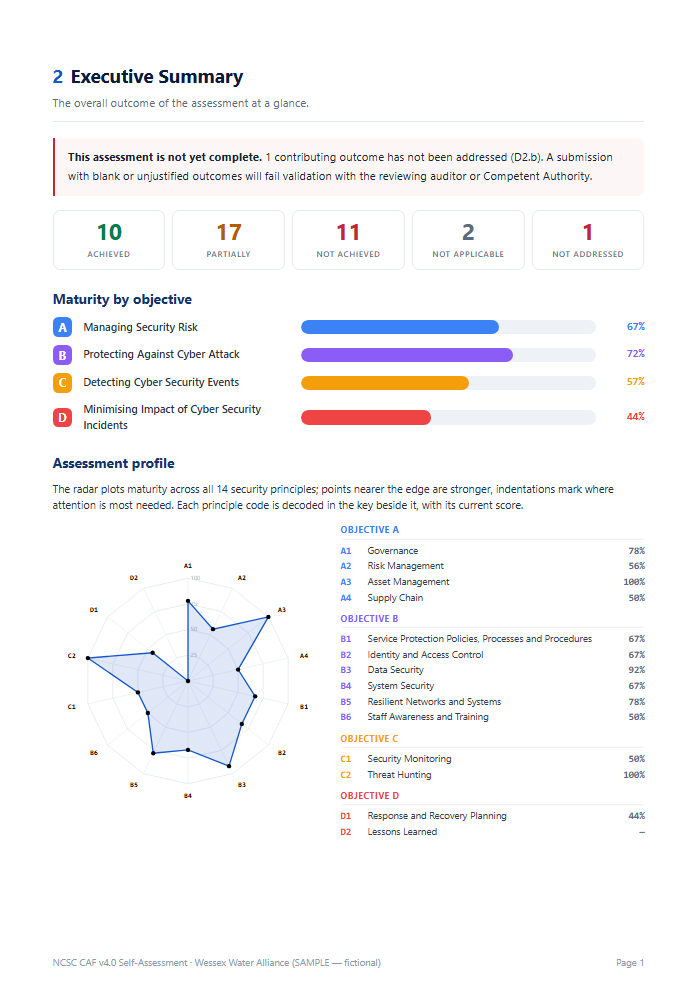
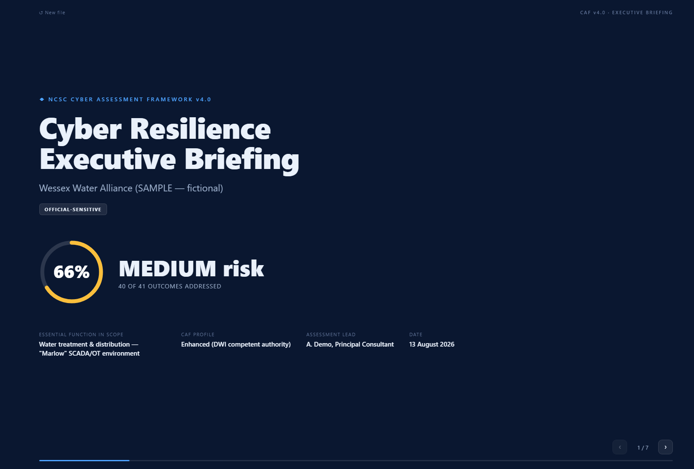

# NCSC CAF v4.0 Assessment Toolkit

A pair of self-contained, offline HTML tools for carrying out and presenting an assessment against the UK National Cyber Security Centre's [Cyber Assessment Framework (CAF) version 4.0](https://www.ncsc.gov.uk/collection/cyber-assessment-framework). The toolkit supports both self-assessment and independent / third-party assessment: the assessment type and report footer are editable so the output states clearly which it is.

- **Assessment Tool** — score all 41 contributing outcomes against the official NCSC **Indicators of Good Practice (IGPs)**, record evidence, justifications and compensating controls, tune the risk and improvement model per engagement, and generate a full print-ready PDF report.
- **Executive Briefing** — a boardroom slide deck generated from the tool's export, for presenting the outcome to senior stakeholders.

Both are single HTML files. There is no build step, no server, no dependencies and no network calls — open them in a browser and everything runs locally. Nothing you enter ever leaves your machine.

> **Disclaimer.** By default these tools support *self-assessment* and do not constitute a regulatory determination. Where they are used for an independent assessment, set the assessment type and footer accordingly in **Assessment Setup**. Target levels for each outcome are set by your relevant regulator or Competent Authority. Always confirm your requirements against the official CAF and your sector profile.



---

## Contents

- [Quick start](#quick-start)
- [The Assessment Tool](#the-assessment-tool)
  - [Indicators of Good Practice (IGPs)](#indicators-of-good-practice-igps)
  - [Per-engagement tuning](#per-engagement-tuning)
  - [Report footer & assessment type](#report-footer--assessment-type)
- [The Executive Briefing](#the-executive-briefing)
- [How the two fit together](#how-the-two-fit-together)
- [Scoring model](#scoring-model)
- [Data, persistence and privacy](#data-persistence-and-privacy)
- [Export formats](#export-formats)
- [Browser support](#browser-support)
- [Repository layout](#repository-layout)
- [Licence and attribution](#licence-and-attribution)

---

## Quick start

1. Download the two HTML files (see [Repository layout](#repository-layout)).
2. Double-click **`NCSC-CAF-v4-Assessment-Tool.html`** to open it in your browser.
3. Click **Sample** in the top-right of the top bar to explore a worked example, or **Assessment Setup** (top of the sidebar) to start your own. The **?** button beside it opens a short in-app guide.
4. Work through the four objectives, rating each contributing outcome and recording evidence.
5. Click **Generate Report** for the PDF, and **JSON** to export a data file.
6. To brief stakeholders, open **`CAF-v4-Executive-Slideshow.html`** and drop your exported JSON onto it.

No installation. To use it from a web server instead, serve the files as static assets — nothing else is required.

---

## The Assessment Tool

`NCSC-CAF-v4-Assessment-Tool.html`

A complete workspace for a CAF v4.0 self-assessment.

### Framework coverage

- All **4 objectives**, **14 principles** and **41 contributing outcomes** of CAF v4.0 (published 6 August 2025), verified against the official framework.
- Correct handling of the **nine binary outcomes** that have no "Partially Achieved" level (A1.a, A1.b, A1.c, A2.c, A3.a, D1.b, D1.c, D2.a, D2.b) — these are rated Achieved / Not Achieved only.
- New-in-v4.0 outcomes are flagged.

### Assessing

- Rate each outcome **Achieved**, **Partially Achieved**, **Not Achieved** or **Not Applicable**.
- **Not Applicable requires a written justification** — the tool prompts for a defensible position (exemption, justification, compensating controls) and flags any N/A left unjustified.
- Record free-text **evidence and commentary** against every outcome.
- A live **validation banner** tracks completeness: outcomes not yet addressed, and N/A claims missing justification, are surfaced until resolved.

### Indicators of Good Practice (IGPs)

Each contributing outcome expands to a checklist of the official **NCSC Indicators of Good Practice** — the 217 indicator statements reproduced verbatim from the CAF v4.0 taxonomy. For every indicator you record one of:

- **Achieved** / **Partially** / **N/A** ticks (Partially is suppressed for the nine binary outcomes, matching the framework);
- a **compensating-control free-text box** that opens on any indicator left *not met*, to describe the mitigation in place.

There is also an **outcome-level compensating-control / rationale box** for the overall judgement.

The indicator checklist is **advisory**: it informs the assessor's rating but does not set it automatically. This supports the real-world case where, for example, four of five indicators are met, a documented compensating control covers the fifth, and the outcome is still rated **Achieved** — with the rationale recorded against it.

### Per-engagement tuning

The risk and improvement model can be adjusted for a specific engagement without editing the tool:

- **Impact / Likelihood / Effort overrides** per outcome — the risk score, risk matrix position and improvement-plan priority recalculate from your values. Overridden outcomes are flagged, and a one-click **reset** restores the defaults.
- **Editable recommended-action text** — the auto-generated remediation wording for any gap can be replaced with engagement-specific guidance.
- **Free-text engagement notes** — add or remove any number of notes against an outcome.

### Report footer & assessment type

In **Assessment Setup** you can set the **assessment type** (e.g. *Independent Assessment* in place of the default *Self-Assessment Report*) and edit the **report footer / disclaimer** text, with a one-click restore to the default wording — so the cover label and footer state unambiguously whether the output is a self-assessment or an independent review.

### Assessment setup

Captures the context that a reviewer or Competent Authority expects, all optional and editable at any time:

- Organisation, sector, Competent Authority, essential function and in-scope systems
- CAF Profile
- Audit team: assessment lead, QC / quality reviewer, team members, client / business owner, Senior Responsible Owner
- Assessment date and period, evidence location, method / notes, version reference, and classification
- **Assessment type** and **editable report footer / disclaimer** (restorable to default)

### Reporting

**Generate Report** produces a branded, paginated, print-ready document (use your browser's *Save as PDF*). It includes:

1. **Cover** — headline maturity, risk posture and key assessment metadata. The cover sub-label reflects the configured assessment type (self-assessment or independent).
2. **About this assessment** — purpose, scope, audience, who assessed it, and a full assessment-details table.
3. **Executive summary** — rating breakdown, maturity by objective, and a 14-principle radar chart with a decoded key.
4. **Risk matrix** — rated outcomes plotted by impact against likelihood, plus the highest residual risks.
5. **Improvement plan** — gaps ranked by priority, with the scoring method explained.
6. **Detailed recommendations (4a)** — a full paragraph per priority gap, generated from the ratings (or your edited action text).
7. **IGP assessment & compensating controls (6a)** — per outcome, the indicator coverage, each not-met indicator with its compensating control, and the outcome-level rationale.
8. **Not Applicable register** — every N/A declaration with its justification.
9. **Contributing outcome detail** — all 41 outcomes with ratings, an IGP-coverage column, recorded evidence and any engagement notes.

The footer on every page reflects the editable disclaimer / assessment-type text.



### Sample data

The **Sample** button (top-right of the top bar) populates a realistic, fictional water-sector OT assessment so you can see every feature — including a mix of all rating states, justified N/A entries, one outcome deliberately left blank to demonstrate validation, worked **IGP checklists**, both per-indicator and outcome-level **compensating controls**, a **per-engagement risk override** and an **engagement note**.

---

## The Executive Briefing

`CAF-v4-Executive-Slideshow.html`

A dark, full-screen slide deck for presenting the assessment outcome to a board or senior stakeholders. It is generated entirely from the tool's JSON export.

### Using it

1. Open the file in a browser.
2. Drag your exported JSON onto the window, or click **Choose assessment file**. The JSON the tool auto-saves to disk works directly.
3. Navigate the slides.

### Controls

| Key | Action |
| --- | --- |
| `→` / `Space` / `Page Down` | Next slide |
| `←` / `Page Up` | Previous slide |
| `Home` / `End` | First / last slide |
| `F` | Toggle full-screen |

On-screen arrows and a progress rail are also provided.

### Slides

1. **Title** — headline posture, organisation, classification, assessment type and scope.
2. **Outcome scoring** — the rating breakdown and submission readiness.
3. **Maturity by objective** — the four objectives as scored bars.
4. **CAF Profile compliance** *(when a profile is set)* — targeted outcomes meeting their required level.
5. **Indicator coverage & compensating controls** *(when IGP data is present)* — the proportion of indicators met and the documented compensating controls.
6. **All 41 contributing outcomes** — every outcome coloured by rating.
7. **Security principle profile** — the 14-principle radar with a decoded key.
8. **Risk matrix** — impact vs likelihood, with the highest residual risks.
9. **Improvement priorities** — category counts and the top gaps to brief.
10. **Next steps** — recommended actions, adapted to the assessment's state. The closing footer reflects the editable disclaimer / assessment-type text.



The briefing is view-only and does not edit the underlying assessment. The CAF Profile compliance and IGP coverage slides appear only when the export carries that data, so older exports still render correctly.

---

## How the two fit together

```
┌─────────────────────────────┐        JSON export        ┌──────────────────────────┐
│  Assessment Tool            │  ─────────────────────▶   │  Executive Briefing      │
│  score · evidence · report  │   (schemaVersion 1)       │  board-ready slide deck  │
└─────────────────────────────┘                           └──────────────────────────┘
        │                                                           ▲
        │  auto-saves the same JSON to disk / localStorage          │
        └───────────────────────────────────────────────────────────┘
                        the auto-saved file feeds the briefing directly
```

The tool's JSON export is the single interchange format. The same file:

- **re-imports** into the tool to restore an assessment,
- **feeds** the Executive Briefing, and
- is what the tool **auto-saves** to disk.

So the file the tool saves as you work can be dropped straight onto the briefing.

---

## Scoring model

Maturity is measured **only over rated outcomes** (Achieved / Partially Achieved / Not Achieved). Outcomes marked **Not Applicable are excluded** from the calculation rather than counted as failures; outcomes **Not Addressed** are excluded but flagged as outstanding.

Each rated outcome scores 3 (Achieved), 2 (Partially Achieved) or 1 (Not Achieved). An objective's percentage is its points over its maximum possible points across rated outcomes.

**Improvement priority** ranks the gaps:

```
Priority = ( Impact × Likelihood × Gap severity ) ÷ Effort
```

- **Impact (1–5)** — how badly a failure of the outcome would affect the essential function.
- **Likelihood (1–5)** — current exposure to exploitation or failure.
- **Gap severity** — 2 for Not Achieved, 1 for Partially Achieved.
- **Effort (1–5)** — relative cost and complexity to remediate.

Higher scores are addressed first. Items are also tagged **Quick win**, **Critical**, **Strategic** or **Foundational**. The impact / likelihood / effort weightings are the toolkit's own heuristic to aid prioritisation — they are not part of the CAF and should be reviewed against your own risk assessment.

---

## Data, persistence and privacy

Everything is stored locally. There are no accounts, no telemetry and no network requests.

The Assessment Tool saves your work in three layers:

1. **Automatic in-browser save** — every change is written to the browser's `localStorage` (debounced). On reopening, the tool offers to restore your last session. This survives refreshes, tab closes and reboots.
2. **Auto-save to a file** *(Chromium browsers)* — click **Auto-save to file…** and choose a location once; the tool then writes back to that file automatically as you work, using the File System Access API.
3. **Manual export** — the **JSON** button downloads a full backup at any time.

> `localStorage` is per-browser and per-machine, and is cleared by private/incognito mode on close. For portability between machines, or as a durable backup, use the JSON export or the disk auto-save.

---

## Export formats

### JSON (`schemaVersion: 1`)

The complete, re-importable state and the interchange format for the briefing. Top-level structure:

```jsonc
{
  "schemaVersion": 1,
  "framework": { "name": "...", "version": "4.0", "published": "2025-08-06",
                 "objectives": 4, "principles": 14, "contributingOutcomes": 41 },
  "assessment": {
    "organisation": "...", "leadAssessor": "...", "date": "...",
    "essentialFunction": "...", "cafProfile": "...", "inScopeSystems": "...",
    "sector": "...", "competentAuthority": "...", "qcReviewer": "...",
    "teamMembers": "...", "clientOwner": "...", "seniorResponsibleOwner": "...",
    "assessmentPeriod": "...", "evidenceLocation": "...", "method": "...",
    "version": "...", "classification": "...",
    "reportType": "Independent Assessment",   // editable cover label (blank = default "Self-Assessment Report")
    "reportFooter": "...",                     // editable footer / disclaimer (blank = default wording)
    "exportedAt": "<ISO 8601>"
  },
  "completeness": {
    "addressed": 40, "outstanding": ["D2.b"],
    "unjustifiedNotApplicable": [], "readyForSubmission": false
  },
  "summary": {
    "overallPercent": 64, "rated": 39,
    "achieved": 9, "partiallyAchieved": 17, "notAchieved": 12,
    "notApplicable": 2, "notAddressed": 1,
    "byObjective": [ { "id": "A", "title": "...", "percent": 67,
                       "rated": 9, "notApplicable": 0, "notAddressed": 0 } ],
    "improvementPlan": [ { "ref": "B2.c", "objective": "B", "name": "...",
                           "rating": "NOT", "impact": 5, "likelihood": 5,
                           "effort": 3, "priority": 16.7, "category": "critical",
                           "action": "..." } ]
  },
  "contributingOutcomes": [
    {
      "ref": "A1.a", "objective": "A", "principle": "A1",
      "principleTitle": "Governance", "name": "Board Direction",
      "newInV4": false, "partiallyAchievedAvailable": false,
      "rating": "ACH", "ratingLabel": "Achieved",
      "impact": 5, "likelihood": 3, "effort": 2, "riskScore": null,
      "impactDefault": 5, "likelihoodDefault": 3, "effortDefault": 2,
      "riskOverridden": false,                  // true when impact/likelihood/effort were tuned for this engagement
      "recommendedAction": "...",               // the action text (auto-generated, or edited)
      "actionEdited": false,                    // true when recommendedAction was overridden
      "engagementNotes": ["..."],               // free-text notes added against the outcome
      "compensatingControl": "...",             // outcome-level compensating-control / rationale text
      "igp": [                                  // the official NCSC Indicators of Good Practice for this outcome
        {
          "statement": "...",                   // verbatim indicator text
          "status": "ACH",                      // ACH | PAR | NA | NONE (not assessed)
          "statusLabel": "Achieved",
          "compensatingControl": "..."          // present when the indicator is not met
        }
      ],
      "igpSummary": { "ach": 4, "par": 0, "na": 1, "notmet": 0, "total": 5, "addressed": 5 },
      "justification": null, "evidence": "...",
      "justificationRequired": false, "justificationMissing": false
    }
    // ... 41 outcomes
  ]
}
```

Rating codes: `ACH`, `PAR`, `NOT`, `NAP` (Not Applicable), `UNSET` (Not Addressed). Indicator (`igp[].status`) codes: `ACH`, `PAR`, `NA`, `NONE`.

The `igp[]`, `compensatingControl`, override and engagement-note fields were added alongside the indicator-checklist feature; exports that predate it omit them and still re-import and render in the briefing without change.

### CSV

A flat extract for spreadsheets and analysis tools (Excel, Timeline Explorer, pandas, etc.). The **41-outcome data table comes first**, so its column header is row 1 and analysis tools detect the full structure correctly; the assessment metadata and summaries are appended below as clearly-labelled sections rather than as a preamble.

The data table has one row per contributing outcome with the following columns:

```
CO Ref, Objective, Objective Title, Principle, Principle Title,
Contributing Outcome, New in v4.0, Partially Achieved Available,
Rating, Rating Label, Impact (1-5), Likelihood (1-5), Effort (1-5),
Risk Score, Priority Score,
Justification (required for Not Applicable), Justification Missing,
Evidence & Commentary
```

Impact, likelihood, effort, risk and priority are populated so the file is directly usable for analysis and sorting, and reflect any per-engagement overrides. After the table, three sections follow: **Objective Summary** (per-objective counts and scores), **Assessment Details** (the setup fields that have been filled in), and **Overall & Completeness** (headline maturity, readiness, and outstanding items).

Indicator-level detail (IGP status and compensating controls) is carried in the **JSON export** and the **PDF report** rather than the flat CSV.

Uses RFC 4180 quoting and a UTF-8 BOM so it opens cleanly in Excel, and multi-line justifications and evidence survive intact. Parses as a clean 41 × 18 table when read with a standard CSV reader.

### PDF

Produced via the browser's *Save as PDF* from the **Generate Report** view (see [Reporting](#reporting)).

---

## Browser support

Built with standard HTML, CSS and vanilla JavaScript — no frameworks.

| Feature | Chrome / Edge | Firefox | Safari |
| --- | --- | --- | --- |
| Assessment, scoring, reporting | ✓ | ✓ | ✓ |
| In-browser auto-save & restore | ✓ | ✓ | ✓ |
| Auto-save to a chosen file | ✓ | — *(use JSON export)* | — *(use JSON export)* |
| PDF export (Save as PDF) | ✓ | ✓ | ✓ |
| Executive Briefing | ✓ | ✓ | ✓ |

**Printing the report:** choose **Save as PDF** as the destination, set **Margins: Default**, turn **Background graphics ON** and turn **Headers and footers OFF** (this removes the browser's date and file-path stamps). Chrome and Edge give the most faithful result; the full-bleed cover may show a margin in other browsers.

---

## Repository layout

```
.
├── NCSC-CAF-v4-Assessment-Tool.html       # the assessment workspace + report
├── CAF-v4-Executive-Slideshow.html        # the briefing deck (loads exported JSON)
├── CAF-v4-SAMPLE-export.json              # in-progress sample export (try the briefing with this)
├── CAF-v4-SAMPLE-COMPLETED-export.json    # fully-rated sample (all 41 outcomes, IGPs, compensating controls)
├── CAF-v4-SAMPLE-assessment.json          # the sample import file (Import JSON)
├── docs/
│   ├── screenshot-tool.png            # dashboard (shown at the top of this README)
│   ├── screenshot-report.png          # the generated PDF report
│   └── screenshot-slideshow.png       # the executive briefing deck
└── README.md
```

> The README embeds three screenshots from `docs/`. Add your own PNGs at those paths (or update the image links) so they render on GitHub.

---

## Licence and attribution

The CAF itself is Crown copyright: **CAF content © Crown copyright 2025, reproduced under the [Open Government Licence v3.0](https://www.nationalarchives.gov.uk/doc/open-government-licence/version/3/).** The Open Government Licence version (v3.0) is unrelated to the CAF framework version (v4.0).

Add your own licence for the toolkit code in a `LICENSE` file and reference it here (for example, MIT for a permissive open-source release). Until then, no code licence is granted by default.

The official framework is published by the NCSC: <https://www.ncsc.gov.uk/collection/cyber-assessment-framework>
